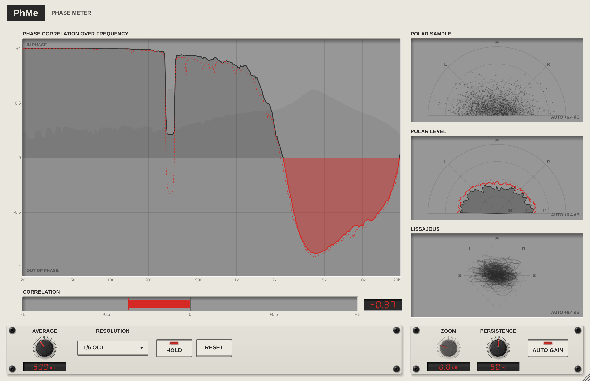
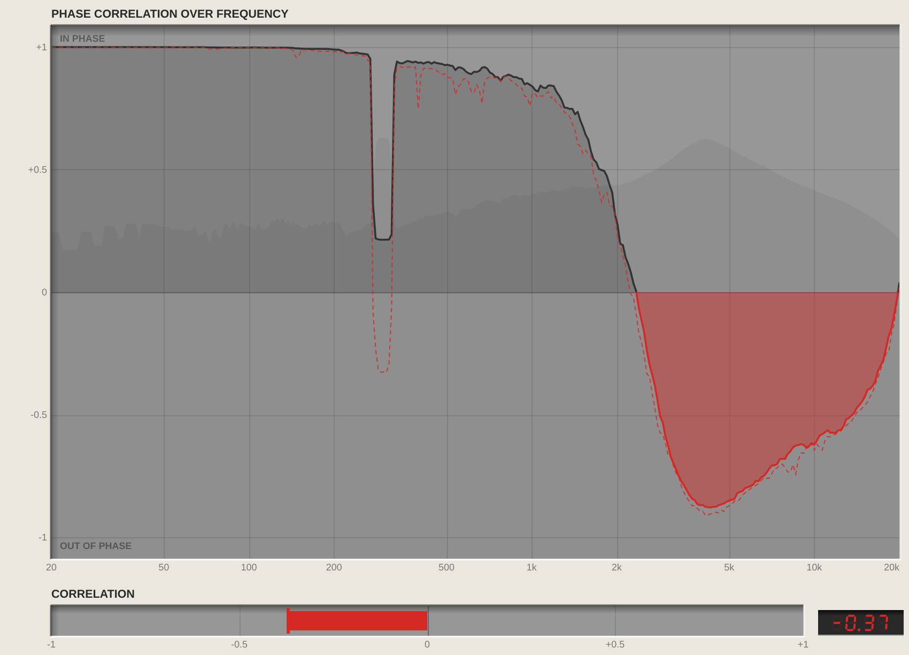
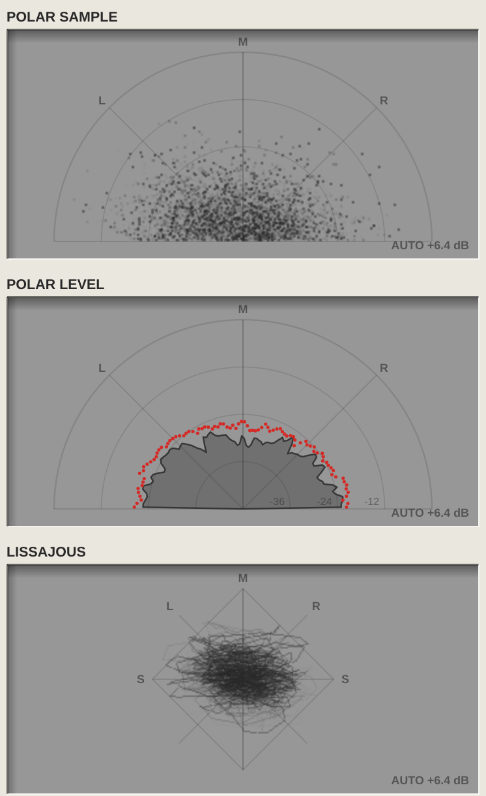
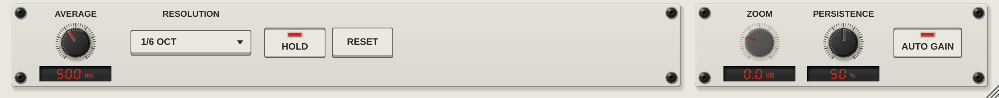

# PhMe – Phase Meter

PhMe is a VST3 phase meter for stereo signals. Its main display shows the **phase correlation over frequency**, so you can see at a glance which frequency ranges sit in phase, which are wide and which cancel in mono. Next to it are three vectorscopes: **polar sample**, **polar level** and **Lissajous**. The audio passes through unchanged and without latency.



<sub>Screenshot with a test signal: mono bass below 200 Hz, wide mids, a 300 Hz sine on the left channel only, and 3–5 kHz out of phase.</sub>

---

## Features

- **Phase correlation over frequency**
  - 20 Hz – 20 kHz on a logarithmic axis, from +1 (in phase) through 0 (wide) to −1 (out of phase).
  - Out-of-phase ranges show in red. Quiet bands fade out, and a faint spectrum lies behind the curve.
  - Adjustable smoothing over frequency (1/3 to 1/48 octave) and time averaging (50 ms to 5 s).
  - **HOLD** draws a dashed line at the lowest correlation per frequency since the last reset.
- **Broadband correlation meter** with a seven-segment readout
- **Three vectorscopes**
  - **Polar sample**: every sample as a dot on a half disc.
  - **Polar level**: the level per stereo direction, with peak dots.
  - **Lissajous**: the classic goniometer.
- **Auto gain** for the scopes, or a manual **ZOOM**; adjustable afterglow (**PERSISTENCE**)
- **Zero latency, bit-transparent**: the plugin only reads the audio.
- **Hardware-style interface**
  - Raised, screwed panels, knurled knobs and LED buttons.
  - Seven-segment value displays and recessed grey displays.
- **Light on the host**
  - The analysis and drawing run at 30 frames per second.
  - Static parts of the displays are cached; the curve redraws at most 15 times per second.

---

## Getting started

1. Insert **PhMe** on any stereo track, bus or the master.
2. Press play.
3. Read the curve:
   - **+1 (top)**: left and right are identical in that band, so it is mono-safe.
   - **around 0**: the band is wide or decorrelated, for example reverb or stereo synths.
   - **below 0 (red)**: the band cancels when summed to mono. Check polarity, timing or stereo effects.
4. Switch on **HOLD** to catch short out-of-phase moments over a whole passage. Click the display or press **RESET** to start again.

---

## Phase correlation over frequency



| Element | Meaning |
|---|---|
| Dark area above 0 | In-phase content (positive correlation) |
| Red area below 0 | Out-of-phase content (negative correlation) |
| Fading | Quiet bands are drawn fainter; bands below −100 dB count as +1 |
| Faint grey area | Spectrum of the signal (−100 … 0 dB), for orientation |
| Dashed red line | Lowest correlation per frequency since the last reset (**HOLD**) |
| **CORRELATION** bar | Broadband correlation of the whole signal, with readout |

---

## Vectorscopes



All three scopes use mid/side axes with the image upright: **mono is vertical**, a signal on one channel lies on the **L** or **R** diagonal, and **out-of-phase** content is horizontal.

- **POLAR SAMPLE**: every sample as a dot. A sample and its negative mean the same stereo position, so the lower half is folded up into a 180° view.
- **POLAR LEVEL**: the level per direction in 2° sectors, 48 dB from the centre to the edge. The red dots are the peaks of the last 1.5 s.
- **LISSAJOUS**: the samples joined by lines over the full plane. The diamond marks full scale of one channel.

The current scope gain is shown at the bottom right of each scope, for example `AUTO +6.4 dB`.

<br clear="right">

---

## Controls



| Control | Range | Description |
|---|---|---|
| **AVERAGE** | 50 ms … 5 s | Time averaging of the correlation (curve and bar) |
| **RESOLUTION** | 1/3 … 1/48 oct | Smoothing over frequency |
| **HOLD** | on / off | Shows the lowest correlation per frequency since the last reset |
| **RESET** | – | Clears the hold line; clicking the display does the same |
| **ZOOM** | −12 … +36 dB | Gain of the scopes when **AUTO GAIN** is off. At 0 dB, full-scale mono touches the edge. |
| **PERSISTENCE** | 0 … 100 % | Afterglow of the polar sample and Lissajous scopes, and fall time of the polar level |
| **AUTO GAIN** | on / off | The scopes follow the level (the peak falls back over 1.5 s) |

All settings are saved with the project.

---

## How it works

### Audio thread

- `processBlock` only copies the samples into a lock-free FIFO (`juce::AbstractFifo`, about 2.7 s at 48 kHz) and leaves the audio untouched.
- When the editor is closed, the FIFO simply fills up and nothing else happens.

### Correlation over frequency (message thread)

- Short-time FFT of both channels: 8192 points at 44.1/48 kHz (larger at higher sample rates), Hann window, 75 % overlap.
- Per bin, three quantities are averaged exponentially with the **AVERAGE** time:
  - the cross power `Re(L · conj R)`
  - the powers `|L|²` and `|R|²`
- For each of the 320 log-spaced display points, these are summed over the band given by **RESOLUTION**, using prefix sums so that every band costs O(1):

```
r(f) = Σ Re(L · conj R) / sqrt( Σ|L|² · Σ|R|² )        −1 … +1
```

### Scopes

- All three scopes plot mid/side: `x = (R − L)/√2`, `y = (L + R)/√2`.
- The afterglow images are software images written pixel by pixel. With a GPU-backed image (Direct2D on Windows), each frame would otherwise have to travel to and from the graphics card.
- Displays, grids and labels are rendered once into cached images at the physical pixel scale.

---

## Building

### Requirements

- CMake 3.22 or newer
- A C++20 compiler (developed with MSVC / Visual Studio 2022 on Windows)
- [JUCE](https://github.com/juce-framework/JUCE) 8, included as a git submodule in `libs/JUCE`

### Clone and build

```bash
git clone --recursive <repository-url> PhMe
cd PhMe
cmake -B build
cmake --build build --config Release --target PhMe_VST3
```

The plugin ends up in `build/PhMe_artefacts/Release/VST3/PhMe.vst3`. Copy it, or link it, into your VST3 folder (on Windows `C:\Program Files\Common Files\VST3`), for example as a junction from an administrator command prompt:

```bat
mklink /J "C:\Program Files\Common Files\VST3\PhMe.vst3" "<path-to-PhMe>\build\PhMe_artefacts\Release\VST3\PhMe.vst3"
```

> **Notes**
> - Close the DAW before building. A loaded plugin locks the file, and the linker then fails with LNK1104 / LNK1168.
> - Use **Release** (or **RelWithDebInfo**) for actual work. Debug builds are many times slower.

The CMake option `PHME_BUILD_PLUGIN_HOST` (on by default) also builds JUCE's AudioPluginHost for debugging. Turn it off with `-DPHME_BUILD_PLUGIN_HOST=OFF`.

---

## Project structure

```
PhMe/
├── CMakeLists.txt
├── libs/JUCE/               JUCE (git submodule)
├── docs/                    screenshots for this README
└── source/
    ├── PluginProcessor.*    pass-through, sample FIFO, parameters
    ├── PluginEditor.*       analysis timer, layout and controls
    ├── Analyser.h           correlation over frequency (STFT), broadband correlation
    ├── Views.h              correlation display and meter, the three vectorscopes
    ├── PhMeLookAndFeel.h    knobs, LED buttons, seven-segment displays
    └── Style.h              panels, screws, displays
```

---

## Tested with

- pluginval at strictness level 7
- Ableton Live (Windows, VST3)
